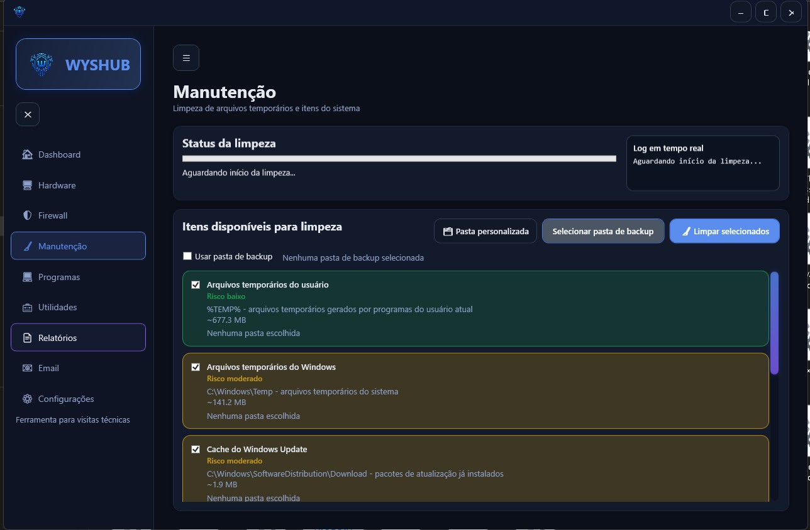
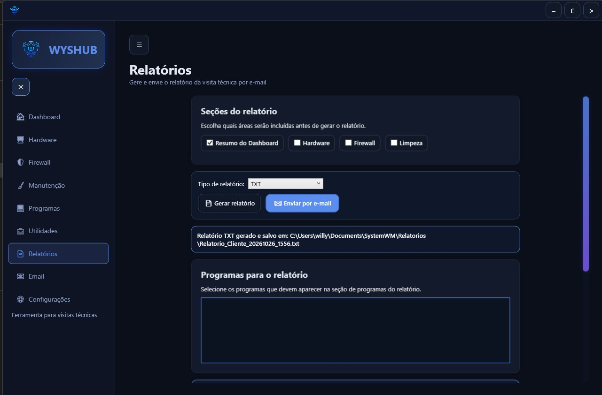
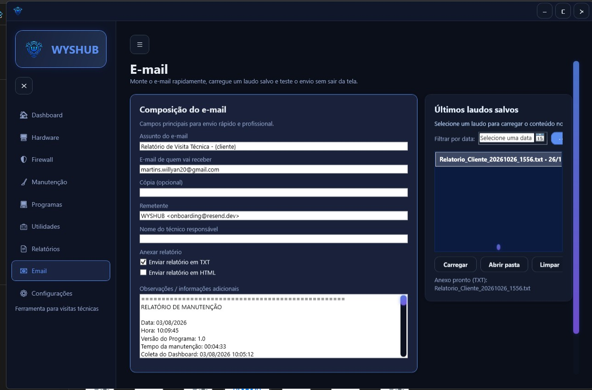

# WYSHUB

  
  
  

Aplicativo desktop para Windows voltado a suporte técnico: diagnóstico de hardware e rede, verificação do firewall, limpeza de arquivos temporários, auditoria de programas instalados e geração de relatórios enviados por e-mail.

## Funcionalidades

- **Diagnóstico da máquina:** status geral, hardware, desempenho, temperatura e uso de recursos.
- **Rede:** identificação de problemas de conectividade.
- **Firewall:** verificação do status do Firewall do Windows.
- **Limpeza e manutenção:** remoção de arquivos temporários, cache e dados de uso do sistema.
- **Programas instalados:** listagem para auditoria de software.
- **Relatórios:** geração de relatório com os dados coletados, pronto para entrega ao cliente.
- **Envio por e-mail:** envio do relatório pela integração com API de e-mail configurada no app.
- **Registro de visitas técnicas:** informações do atendimento reunidas no mesmo relatório.

## Fluxo de uso

1. O app coleta as informações da máquina.
2. Os dados são exibidos no painel inicial.
3. O técnico executa as ações de verificação e manutenção.
4. O relatório é gerado com os resultados.
5. O relatório é enviado por e-mail ao destinatário.

## Telas

### Tela inicial

Painel central com status geral da máquina, hardware, desempenho, temperatura e acesso rápido às funções.

### Limpeza e manutenção

Remoção de temporários, cache e dados de uso do sistema.

### Geração de relatórios

Consolida as informações coletadas em um relatório exportável.

### Envio de e-mail

Define remetente e destinatário e envia o relatório.

## Tecnologias

- .NET 8
- WPF (interface desktop)
- Windows APIs para diagnóstico e manutenção
- Integração com API de e-mail
- Distribuição em versão portátil e instalador

## Instalação

### Versão portátil

1. Baixe a pasta de release.
2. Extraia em qualquer local.
3. Execute `WYSHUB.exe`.

### Versão instalada

1. Baixe o instalador.
2. Execute o arquivo de instalação e siga o assistente.
